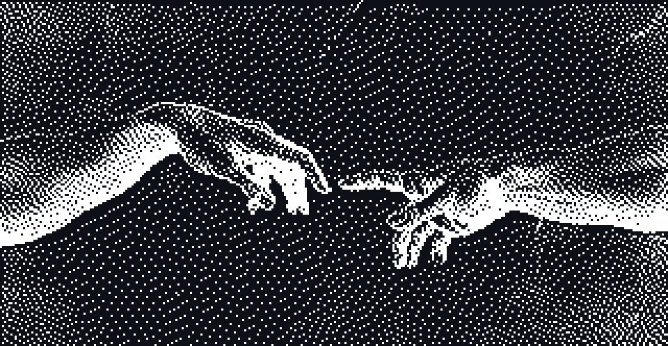

# Hi 👋, I'm AUSTIN SUNESH

**CS & Applied Statistics @ University of Toronto**

`Low-level systems · Machine Learning · Artifactual Intelligence · Robotics`

Learning how things work from the ground up, then building them.

---

## 🚀 About Me

I am a <b>Computer Science and Applied Statistics</b> student at the <b>University of Toronto</b>.

I build things because I genuinely want to learn the fundamentals of how they work.

I am drawn to solving problems with real depth, such as <b>low-level systems</b>, <b>mathematical ML</b>, and <b>robotics</b>.

I am eager to learn new skills, take feedback seriously, and am willing to put in the hard work needed to grow and succeed.

 

---

## 🔭 Open To

**Summer 2027 opportunities** in:

- 💻 Software Engineering
- 🧠 Machine Learning
- 🩺 Medical Robotics
- 📈 Quantitative Development & Research

If you're building something interesting, let's connect.

---

## 🤝 Connect

  
  
  

---

##v💻 Tech Stack

Languages

  

Low-Level & Architecture

   

---

## 📊 GitHub Stats

  

  
  

---

## 📈 Activity Graph

  

